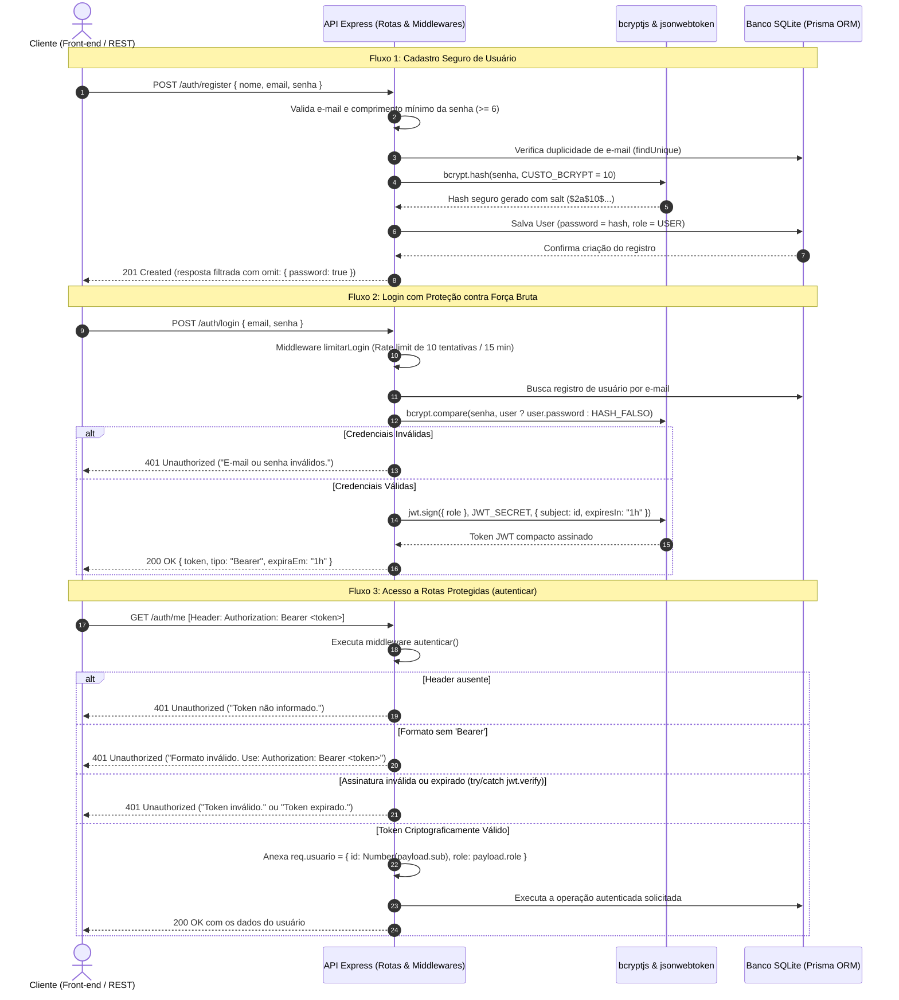

# API Biblioteca

**Grupo:** Filipe Gomes, João Miguel, Arthur Chave - 3º AI - ETECAMP

---

## 1. Sobre o projeto

A **API Biblioteca** é uma aplicação backend RESTful concebida para a gestão moderna de acervos bibliográficos e controle de retiradas de livros, construída sobre o ecossistema Node.js com Express 5 e Prisma ORM 7. O sistema estabelece uma segregação estrita de privilégios entre dois perfis institucionais: o **Administrador (`ADMIN`)**, que possui a custódia do catálogo de obras literárias (cadastro, atualização e remoção com gestão de exemplares), e o **Leitor (`USER`)**, que consulta as obras disponíveis e solicita empréstimos. O recurso central da aplicação é o **`Emprestimo`**, registro que materializa a posse temporária de um livro por um leitor e cuja integridade é blindada simultaneamente por controle de acesso baseado em funções (RBAC) e pela regra de titularidade de dados (regra do dono).

---

## 2. Como rodar

Para clonar, configurar e executar a API localmente a partir do zero, execute os comandos abaixo na raiz do projeto:

```bash
# 1. Instalar todas as dependências do ecossistema Node.js
npm install

# 2. Configurar o arquivo de variáveis de ambiente
copy .env.example .env     # No Linux ou macOS: cp .env.example .env

# 3. Aplicar as migrações estruturais do banco de dados SQLite
npx prisma migrate dev

# 4. Compilar o cliente de alta performance do Prisma ORM 7
npx prisma generate

# 5. Popular a base de dados com o conjunto de sementes (1 ADMIN, 2 Leitores, Livros e Empréstimos)
npx prisma db seed

# 6. Inicializar o servidor da aplicação em modo de desenvolvimento
npm run dev
```

A API estará acessível em: **`http://localhost:3000`** (onde também é servida a interface web em `public/index.html`).

### Usuários de Teste Pré-configurados no Seed (Senha padrão: `Senha123`):

| E-mail | Perfil (Role) | Papel Institucional no Sistema |
|---|:---:|---|
| `admin@biblioteca.com` | `ADMIN` | Administrador geral do acervo e dos usuários |
| `ana@biblioteca.com` | `USER` | Leitora regular (possui empréstimo ativo no seed) |
| `bruno@biblioteca.com` | `USER` | Leitor regular (possui empréstimo ativo no seed) |

---

## 3. Mapa de rotas

| Método | Rota | Nível de Acesso | Proteção Aplicada | Descrição da Operação |
|---|---|---|---|---|
| `POST` | `/auth/register` | Pública | Validação de campos e hash bcrypt | Cadastro de novo leitor (recebe sempre o perfil padrão `USER`) |
| `POST` | `/auth/login` | Pública | Rate limit + bcrypt.compare + JWT | Autenticação do usuário e emissão do token Bearer com expiração |
| `GET` | `/auth/me` | Logado | Middleware `autenticar` | Retorna o perfil cadastral do usuário extraído do próprio token |
| `PATCH` | `/auth/senha` | Logado | `autenticar` + conferência de senha | Permite a troca de senha validando previamente a senha antiga |
| `GET` | `/livros` | Pública | Acesso aberto | Lista todas as obras do catálogo, estoque e disponibilidade |
| `GET` | `/livros/:id` | Pública | Acesso aberto | Retorna os detalhes específicos de uma obra pelo ID |
| `POST` | `/livros` | ADMIN | `autenticar` + `autorizar('ADMIN')` | Adiciona um novo título e sua quantidade de exemplares |
| `PUT` | `/livros/:id` | ADMIN | `autenticar` + `autorizar('ADMIN')` | Altera dados cadastrais de uma obra existente |
| `DELETE` | `/livros/:id` | ADMIN | `autenticar` + `autorizar('ADMIN')` | Exclui uma obra do catálogo |
| `GET` | `/emprestimos` | Logado | `autenticar` (filtro automático) | `USER` visualiza apenas os seus; `ADMIN` audita todos |
| `GET` | `/emprestimos/meus`| Logado | `autenticar` | Endpoint direto para consulta exclusiva das retiradas do leitor |
| `GET` | `/emprestimos/:id` | Dono ou ADMIN | `autenticar` + `carregarComPermissao` | Exibe dados de um empréstimo específico (404 antes de 403) |
| `POST` | `/emprestimos` | Logado | `autenticar` (dono vem do token) | Registra retirada de livro; `leitorId` é extraído do token |
| `PUT` | `/emprestimos/:id` | Dono ou ADMIN | `autenticar` + `carregarComPermissao` | Registra devolução do livro ao acervo (404 antes de 403) |
| `DELETE` | `/emprestimos/:id` | Dono ou ADMIN | `autenticar` + `carregarComPermissao` | Exclui ou cancela um empréstimo (404 antes de 403) |
| `GET` | `/users` | ADMIN | `autenticar` + `autorizar('ADMIN')` | Lista todos os usuários cadastrados (sem expor senhas) |
| `PATCH` | `/users/:id/role` | ADMIN | `autenticar` + `autorizar('ADMIN')` | Atualiza o perfil institucional de um usuário (`USER` ou `ADMIN`) |

---

## 4. Matriz de permissões

| Ação do Sistema | Visitante (Sem Token) | Leitor Autenticado (`USER`) | Administrador (`ADMIN`) |
|---|:---:|:---:|:---:|
| Criar conta (`POST /auth/register`) | **201** | **201** | **201** |
| Fazer login (`POST /auth/login`) | **200** | **200** | **200** |
| Consultar os próprios dados (`GET /auth/me`) | 401 | **200** | **200** |
| Trocar a própria senha (`PATCH /auth/senha`) | 401 | **200** | **200** |
| Consultar catálogo de livros (`GET /livros`) | **200** | **200** | **200** |
| Detalhar livro por ID (`GET /livros/:id`) | **200** | **200** | **200** |
| Cadastrar novo livro no acervo | 401 | 403 | **201** |
| Editar ou excluir livro do acervo | 401 | 403 | **200 / 204** |
| Listar empréstimos (`GET /emprestimos`) | 401 | **200** *(vê só os seus)* | **200** *(vê todos)* |
| Retirar exemplar (`POST /emprestimos`) | 401 | **201** | **201** |
| Devolver o próprio empréstimo | 401 | **200** | **200** |
| Devolver empréstimo de outro leitor | 401 | 403 | **200** |
| Consultar empréstimo inexistente (`ID 9999`) | 401 | 404 *(antes de 403)* | 404 |
| Listar usuários (`GET /users`) | 401 | 403 | **200** |
| Alterar perfil de usuário (`PATCH /users/:id/role`) | 401 | 403 | **200** |

---

## 5. Como funciona a autenticação

### Diagrama do Ciclo de Autenticação e Requisições Protegidas



### Explicação do Código de Autenticação

#### 1. Cadastro com Hash Lento e Salt (`src/controllers/authController.js`)
Ao receber a solicitação de registro, a aplicação higieniza as entradas e valida a extensão mínima da senha. O texto puro da credencial jamais toca o banco de dados: ele é alimentado no método `bcrypt.hash(senha, CUSTO_BCRYPT)` com custo 10. O algoritmo gera uma semente pseudoaleatória criptográfica (salt), mistura-a aos caracteres da senha e itera 1024 vezes. Adicionalmente, o Prisma descarta o retorno da coluna confidencial utilizando `omit: { password: true }`, assegurando que a senha nunca seja transmitida de volta na resposta JSON.

#### 2. Autenticação e Prevenção contra Timing Attacks (`src/controllers/authController.js`)
No endpoint de login, o sistema busca o registro correspondente e submete a senha enviada à função `bcrypt.compare`. Caso o e-mail não exista na base, a aplicação compara a senha digitada contra uma constante estática pré-calculada (`HASH_FALSO`), garantindo que o tempo de resposta em milissegundos seja idêntico para contas existentes e inexistentes, eliminando a viabilidade de ataques de cronometragem (*timing attacks*). A mensagem de retorno é estritamente genérica (`"E-mail ou senha inválidos."`), e o middleware `express-rate-limit` interrompe ataques de força bruta ao atingir 10 tentativas falhas por IP (status 429).

#### 3. Middleware `autenticar` (`src/middlewares/autenticar.js`)
O middleware estabelece a fronteira de identidade cobrindo os três cenários de resposta **401 Unauthorized**:
1. **Cabeçalho ausente:** Requisição desprovida do header `Authorization`;
2. **Formatação incorreta:** Cabeçalhos que não adotam o padrão rigoroso `Bearer <token>`;
3. **Assinatura corrompida ou token expirado:** O método `jwt.verify(token, segredo)` roda sob um bloco defensivo `try/catch`. Caso o token tenha sido adulterado ou ultrapassado o tempo limite de `exp`, o erro é interceptado e convertido em 401 amigável. Sendo válido, o middleware descompacta as claims e define `req.usuario = { id: Number(payload.sub), role: payload.role }`.

---

## 6. Como funciona a autorização

A autorização estabelece os limites operacionais do usuário autenticado. Quando o solicitante tenta realizar uma ação para a qual não tem permissão, a resposta padronizada é **403 Forbidden**. A aplicação adota duas camadas:

### 1. Autorização Baseada em Papéis — RBAC (`src/middlewares/autorizar.js`)
O middleware `autorizar(...perfis)` atua logo após a autenticação bem-sucedida e verifica se o papel (`role`) transportado no token do solicitante consta na lista autorizada da rota:

```javascript
// src/middlewares/autorizar.js
export function autorizar(...perfis) {
  return (req, res, next) => {
    if (!req.usuario || !perfis.includes(req.usuario.role)) {
      return res
        .status(403)
        .json({ erro: "Acesso negado: você não tem permissão para esta ação." });
    }
    next();
  };
}
```

**Exemplos de aplicação nas rotas:**
- `router.get("/", autenticar, autorizar("ADMIN"), listar);` em `userRoutes.js`: impede que leitores comuns visualizem a lista de contas da instituição;
- `router.post("/", autenticar, autorizar("ADMIN"), criar);` em `livroRoutes.js`: restringe a inclusão de novas obras literárias aos administradores.

### 2. Controle por Dono do Recurso — Ownership (`src/controllers/emprestimoController.js`)
O controle de posse assegura o isolamento horizontal entre usuários do mesmo nível. A leitora Ana e o leitor Bruno possuem o perfil `USER`, contudo a Ana não pode consultar nem devolver empréstimos contraídos pelo Bruno.

Na criação (`POST /emprestimos`), a identidade do dono é ancorada no token:
```javascript
// O leitorId é extraído com total segurança do token validado (req.usuario.id).
// Se o corpo da requisição enviar { leitorId: 99 }, esse campo é categoricamente ignorado!
const emprestimo = await prisma.emprestimo.create({
  data: { ...dados, leitorId: req.usuario.id },
  include: incluirRelacoes,
});
```

Na alteração e exclusão (`PUT / DELETE /emprestimos/:id`), a rotina `carregarComPermissao` atesta a existência do recurso antes de qualquer avaliação de permissão (**404 antes de 403**):
```javascript
async function carregarComPermissao(req, res) {
  const id = lerId(req);
  if (!id) {
    res.status(400).json({ erro: "ID inválido." });
    return null;
  }

  // 1. Busca no banco SQLite: se não existir, responde 404 de imediato (404 antes de 403)
  const emprestimo = await prisma.emprestimo.findUnique({ where: { id } });
  if (!emprestimo) {
    res.status(404).json({ erro: "Empréstimo não encontrado." });
    return null;
  }

  // 2. Checagem de posse: somente o leitor titular ou um ADMIN podem prosseguir
  const ehDono = emprestimo.leitorId === req.usuario.id;
  const ehAdmin = req.usuario.role === "ADMIN";
  if (!ehDono && !ehAdmin) {
    res.status(403).json({ erro: "Você só pode alterar ou remover os seus próprios empréstimos." });
    return null;
  }
  return emprestimo;
}
```

---

## 7. Decisões do grupo

- **Payload do token:** Limitamos as claims customizadas unicamente ao identificador numérico **`sub`** e ao papel institucional **`role`** (`USER` ou `ADMIN`), acompanhadas das marcas de tempo `iat` e `exp`. Rejeitamos a inclusão de nomes, e-mails ou dados cadastrais adicionais no token, pois o payload transita meramente codificado em Base64URL e pode ser lido por qualquer interceptador. Essas duas propriedades bastam para que os middlewares tomem decisões imediatas de autorização com mínima sobrecarga de tráfego de rede;
- **Validade do token:** Adotamos o prazo de **1 hora** (`JWT_EXPIRES_IN="1h"`). Em um modelo stateless desprovido de listas de revogação centralizadas, qualquer credencial emitida continua válida até o limite de `exp`. A escolha de 1 hora concilia segurança (caso um leitor se esqueça logado em terminal público da biblioteca ou ocorra alteração de perfil via `PATCH /users/:id/role`) e conveniência durante uma sessão de consulta e retiradas de livros;
- **O que faríamos diferente em produção:**
  1. **HTTPS / TLS Universal:** Imposição irrestrita de certificados TLS com HSTS para neutralizar qualquer inspeção de pacotes em redes Wi-Fi públicas;
  2. **Arquitetura de Refresh Tokens:** Implementação de tokens de acesso de curtíssima duração (10 minutos) e tokens de renovação (Refresh Tokens) armazenados em cookies protegidos com as diretivas `HttpOnly`, `Secure` e `SameSite=Strict`, permitindo a revogação instantânea de sessões no banco de dados;
  3. **Adoção do Argon2id:** Migração do algoritmo bcrypt para o Argon2id, padrão contemporâneo referendado pela OWASP e NIST devido à sua resistência a ataques baseados em memória e ASICs;
  4. **Autenticação Multifator (MFA/TOTP):** Inclusão de um segundo fator de autenticação temporal para usuários com papel `ADMIN`.

---

## 8. Testes

### Como executar os testes

1. **Via VS Code REST Client / Thunder Client:** Abra o arquivo [`requests.http`](file:///c:/Users/Filipe/Downloads/biblioteca/requests.http) e despache as requisições sequenciadas na seção oficial de testes (cenários T1 a T10);
2. **Via Script de Automação:** Com o servidor rodando em segundo plano, execute no terminal:
   ```bash
   npm run testar
   ```
   *(Para acionar a checagem de bloqueio por rate limit, utilize o parâmetro: `npm run testar -- --limite`)*.

### Tabela de Verificação dos Cenários Oficiais (T1 a T10)

| Código | Descrição do Cenário de Teste | Rota & Método | Status Esperado | Status Obtido | Resultado |
|:---:|---|---|:---:|:---:|:---:|
| **T1** | Cadastro de novo usuário válido (resposta sem campo de senha) | `POST /auth/register` | `201 Created` | **201** | **Aprovado** |
| **T2** | Tentativa de cadastro com endereço de e-mail duplicado | `POST /auth/register` | `409 Conflict` | **409** | **Aprovado** |
| **T3** | Tentativa de login submetendo senha incorreta | `POST /auth/login` | `401 Unauthorized` | **401** | **Aprovado** |
| **T4** | Acesso a endpoint protegido sem envio de token | `GET /auth/me` | `401 Unauthorized` | **401** | **Aprovado** |
| **T5** | Acesso a endpoint protegido munido de token JWT válido | `GET /auth/me` | `200 OK` | **200** | **Aprovado** |
| **T6** | Criação de recurso tentando injetar leitorId no body (ignorado) | `POST /emprestimos` | `201 Created` | **201** | **Aprovado** |
| **T7** | Leitor comum tentando modificar empréstimo de outro usuário | `PUT /emprestimos/2` | `403 Forbidden` | **403** | **Aprovado** |
| **T8** | Leitor comum tentando acessar rota exclusiva de ADMIN | `GET /users` | `403 Forbidden` | **403** | **Aprovado** |
| **T9** | Administrador acessando rota restrita de administração | `GET /users` | `200 OK` | **200** | **Aprovado** |
| **T10** | Acesso a empréstimo inexistente (valida 404 antes de checar 403) | `PUT /emprestimos/9999` | `404 Not Found` | **404** | **Aprovado** |

---

## 9. Fontes e ferramentas usadas

- **Plataformas e Ambientes:**
  - [Node.js (v26)](https://nodejs.org/): Ambiente de execução JavaScript server-side assíncrono;
  - [Express 5](https://expressjs.com/): Framework HTTP robusto para definição de rotas e tratamento unificado de erros;
  - [Prisma ORM 7](https://www.prisma.io/): Mapeamento objeto-relacional com tipagem nativa e exclusão de colunas (`omit`);
  - [SQLite com better-sqlite3](https://github.com/WiseLibs/better-sqlite3): Motor de banco de dados relacional embarcado;
- **Bibliotecas de Segurança:**
  - [jsonwebtoken](https://www.npmjs.com/package/jsonwebtoken): Mecanismo de assinatura e conferência de tokens compactos (HS256);
  - [bcryptjs](https://www.npmjs.com/package/bcryptjs): Funções de hash com salt adaptativo para credenciais de acesso;
  - [express-rate-limit](https://www.npmjs.com/package/express-rate-limit): Defesa perimetral contra requisições abusivas e força bruta;
  - [dotenv](https://www.npmjs.com/package/dotenv): Isolamento e carregamento dinâmico de variáveis confidenciais de ambiente;
- **Normas e Guias Oficiais de Segurança:**
  - [IETF RFC 7519 — JSON Web Token (JWT)](https://datatracker.ietf.org/doc/html/rfc7519): Especificação técnica dos formatos de token e claims;
  - [IETF RFC 6750 — Bearer Token Usage](https://datatracker.ietf.org/doc/html/rfc6750): Padronização do cabeçalho `Authorization: Bearer`;
  - [NIST SP 800-63B — Digital Identity Guidelines](https://pages.nist.gov/800-63-3/sp800-63b.html): Orientações técnicas para gerenciamento de credenciais e senhas;
  - [OWASP Cheat Sheet Series](https://cheatsheetseries.owasp.org/): Referenciais em *Password Storage*, *Authentication* e *JSON Web Token*;
  - [MDN Web Docs](https://developer.mozilla.org/): Especificações formais dos códigos de status HTTP 401 e 403;
- **Ferramentas de Desenvolvimento e Inteligência Artificial:**
  - [jwt.io](https://jwt.io/): Plataforma para depuração e inspeção visual das três partes do token;
  - **Antigravity (Google DeepMind)**: Ferramenta de inteligência artificial assistiva empregada no pair programming, revisão arquitetural de código e conferência dos critérios avaliativos da atividade.
